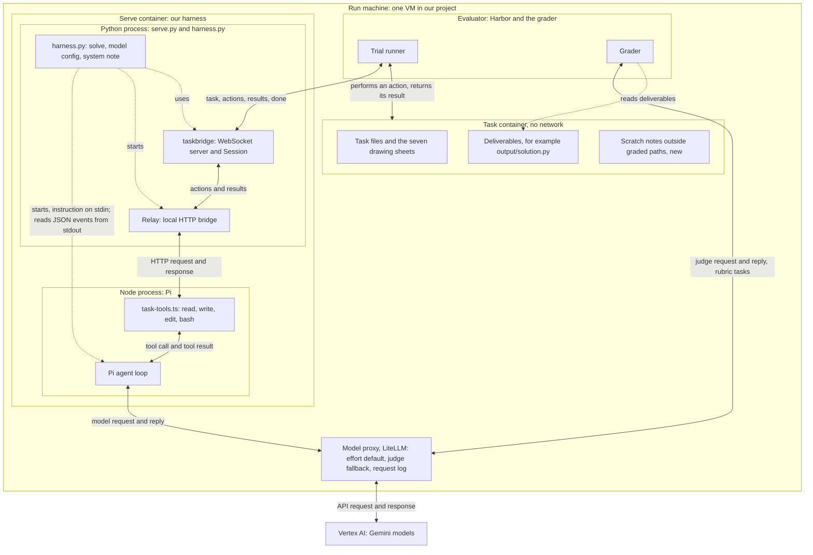
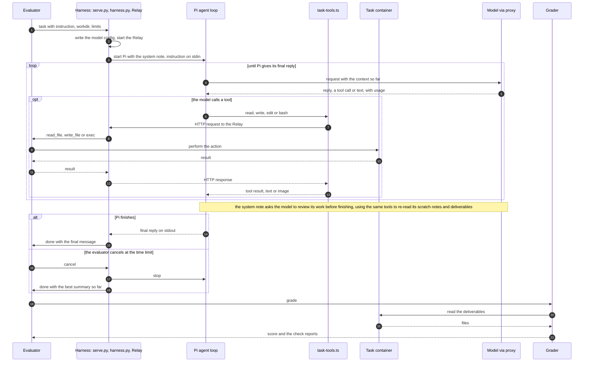
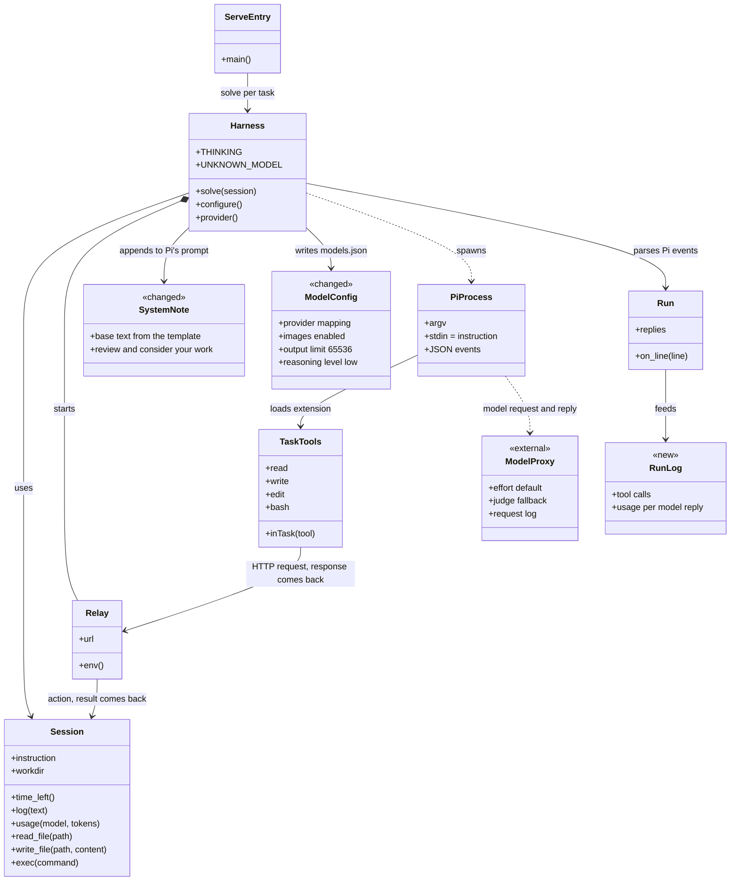
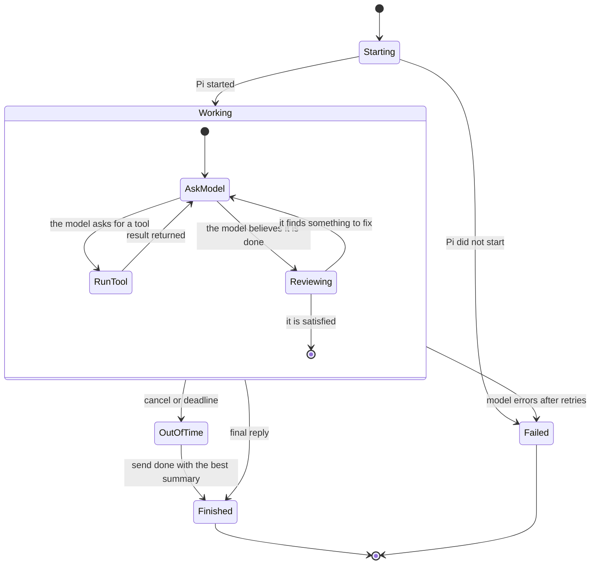
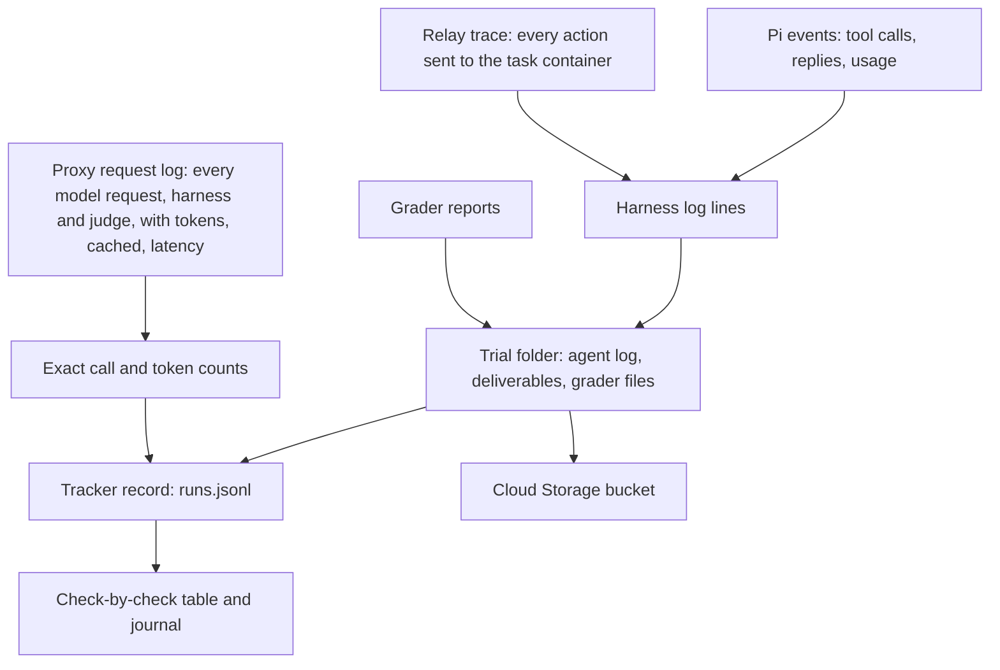

# Rung 1: the architecture (UML)

> **Update 2026-11-27:** the figures for the write-up are in `docs/figures.md` and match what is built (rungs 0, 1 and 2). The diagrams below are the earlier rung 1 proposal (the model reading files with a `read` tool) and are kept as a record; rung 1 as built feeds the files as context, and rung 2 has the `read` tool.

Status: **built as `harnesses/pi-rung1` (2026-11-27), with the changes in 'Rung 1 as built' at the end.** The diagrams below are the earlier proposal: the model there reads files with a `read` tool; as built, the files are fed as context and there is no `read` tool. The diagrams are Mermaid, so they render on
GitHub and in the report page. The structure is the official template's Pi agent harness (`harness.py`,
`task-tools.ts`, `serve.py`, `taskbridge.py`), which we read; boxes marked **new** or **changed** are our
rung 1 changes.

## What rung 1 is, in one paragraph

An off-the-shelf agent harness, **Pi**, in place of rung 0's single model call. The model works in a loop:
it reads files (text and images) with a tool, writes scratch notes and partial outputs, edits, and runs
commands in the task container, and decides itself when it is done. Our additions are small: a system note
asking it to review and consider its work before finishing, and a model configuration that suits our Gemini
models. **No structured self-checks** (no checklist, no `CHECK` lines, no evaluator): the agent may run its own
script with bash if it chooses to, nothing more.

## Scope

| | Rung 0 (v5) | Rung 1 |
|---|---|---|
| Harness | our one-call script | Pi agent loop (template code) |
| Model calls per task | 1 | many (the loop decides) |
| Reading files | pasted into the prompt; images attached | a `read` tool, text and images, on demand |
| Writing | the reply is parsed into files | `write` and `edit` tools, any number of files |
| Running code | no | `bash` in the task container, free-form |
| Intermediate output | none | scratch notes the agent can read back |
| System prompt | task text only | task text plus the template note plus a **review and consider your work** instruction (**new**) |
| Reasoning level | low | low (unchanged, so the only change is the loop) |
| Structured self-checks | none | **none** (by decision) |
| Task, models, grader | same | same |

## 1. Deployment: who runs where

How to read the arrows: a **solid double-headed** arrow is a channel where a request goes one way and the
answer comes back (the label names both). A **dotted** arrow is control or reading: "starts", "uses", "reads".
The model proxy is the one on our VM for our own runs; in the real evaluation the evaluation server provides
its own, with the same behaviour.

Pi never touches the task container directly: `task-tools.ts` replaces Pi's own four tools with versions
that send every action over the relay, through the WebSocket, to the evaluator, which runs it in the task
container. The model proxy sees every model request (the harness's and the judge's), which is how we count
calls.

## 2. Sequence: one task from start to score

Reading a drawing sheet is one `read` call whose result is an image, so the model decides which sheets to
open and when. The loop's length is not fixed: it ends when the model replies without a tool call, when the
evaluator cancels (timeout), or when the harness's own deadline (`STOP_BEFORE_SEC`) arrives.

## 3. Class diagram: the code units

`SystemNote` and `ModelConfig` change from the template (the review instruction; images on, a 65,536
output limit and low reasoning for our Gemini models, which Pi's fallback would otherwise treat as text-only
with a 16,384 limit). `RunLog` is new: it records Pi's tool calls and per-reply usage next to the proxy's
request log.

## 4. State machine: what happens to one task

`Reviewing` is behaviour we ask for in the system note; no code enforces it. Whether the model actually
does it, and whether it helps, is exactly what rung 1 measures.

## 5. What gets recorded

Pi makes the model calls itself, so the harness's own `CALL` lines (rung 0) do not exist. The proxy's
request log is the ground truth for calls and tokens; Pi's own usage events are the cross-check.

## Open items (to settle or verify before building)

1. **Pi's model catalogue and our models.** Pi supplies limits and image support for models it knows. Whether
   `gemini-3.8-flash` and `gemini-4-neon` are in its catalogue is unknown; if not, they fall back to the
   `UNKNOWN_MODEL` settings (text only, 16,384 output tokens), which would silently blind the agent to the
   drawings. Verify with `pi --list-models` in the build, and set the limits explicitly.
2. **Where scratch notes live.** They must not be in a graded path (the grader reads exact deliverable
   paths). Proposal: a scratch folder outside the output folder, named in the system note.
3. **Context growth.** Each opened drawing sheet costs about 1,100 image tokens and stays in the context;
   Pi compacts long conversations. Prompt caching should make the repeated prefix cheap (our cache estimate
   will show it).
4. **The review instruction's wording.** Draft: "Before you finish, re-read your deliverables and your notes,
   compare them with the instruction, and fix what does not match." Wording is a variable to test later;
   rung 1 fixes one wording.
5. **The 65,536-token ceiling still applies per model call**, not per task; the loop gets a new allowance
   every step.
6. **Reasoning level `low`** is assumed, for a like-for-like comparison with rung 0 v5. The template uses the
   highest.

## Rung 1 as built (2026-11-27)

Differences from the proposal above, all from the user's decisions or from checks of Pi itself:

1. **Inputs are fed, not read.** `inputs.py` converts text files in the task container and fetches the drawings
   with `read_file`; the text goes into the prompt (stdin) and the images are passed to Pi as `@file` arguments.
   Tools offered: `write`, `edit`, `bash` (`--tools write,edit,bash`; verified against a mock endpoint: the
   request carries exactly those three). `bash` can still print any file; every tool call is logged.
2. **Pi's catalogue knows `gemini-3.8-flash` (images, 65.5K output) but not `gemini-4-neon`.** Without a fix,
   Neon would have been text only with 16,384 output tokens. `UNKNOWN_MODEL` now has images, 65,536 output and
   `reasoning: true`, so `--thinking low` takes effect. Whether the proxy honours that for Neon is checked in the
   first run's request log.
3. **Pi shrinks images to 2000 x 2000 by default**, rung 0 sent the originals. `images.autoResize: false` in
   Pi's settings; verified: a 3000 x 2000 image arrives as 3000 x 2000.
4. **Thinking level** comes from `REASONING_EFFORT` (default low), like rung 0 v5.
5. **Logging:** `pi: CALL {...}` per model reply and `pi: CALLS {...}` totals in the same shape as rung 0
   (Pi's usage includes a `reasoning` count), `pi: TOOLS {counts, ran_deliverable}` (did the agent run
   `solution.py` on its own), `pi: IMAGES {...}`.
6. **Unverified until the first VM run:** that the local proxy serves Pi's native Gemini route
   (`GOOGLE_GEMINI_BASE_URL`), and that the evaluator's environment sets it for these models.
