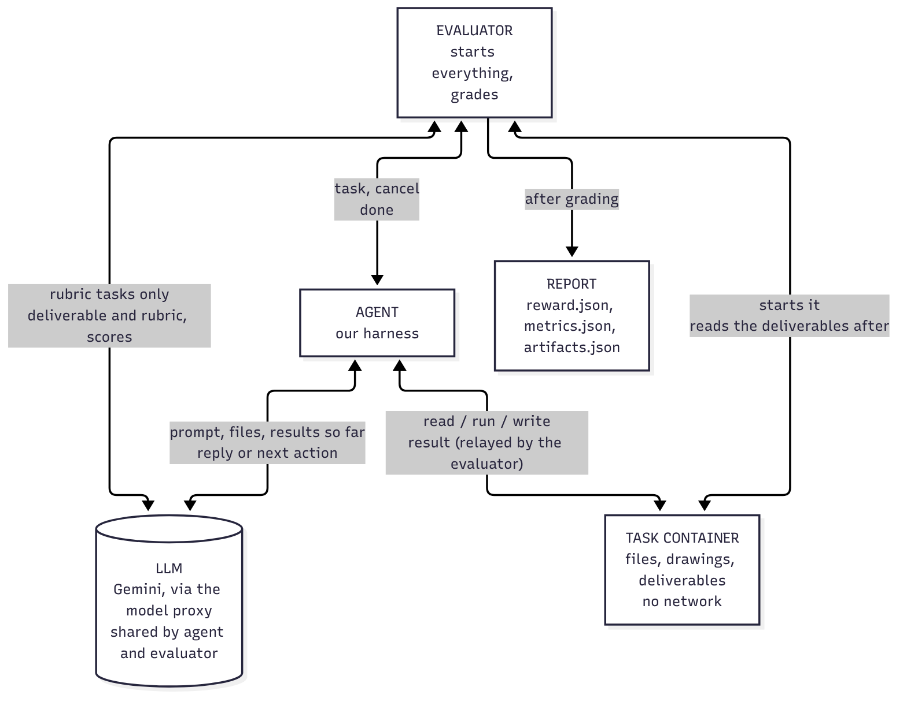
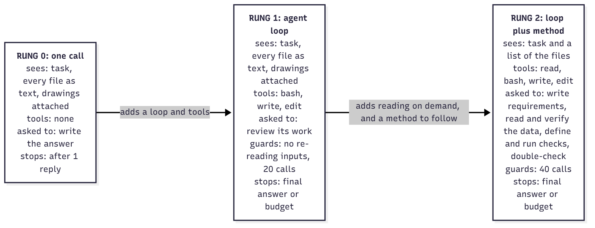
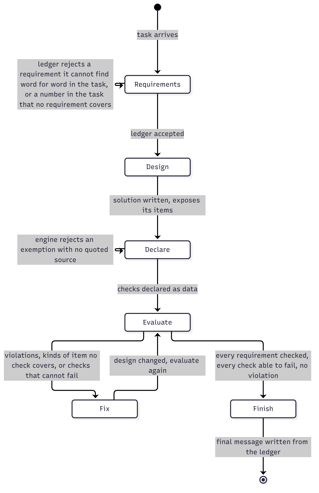
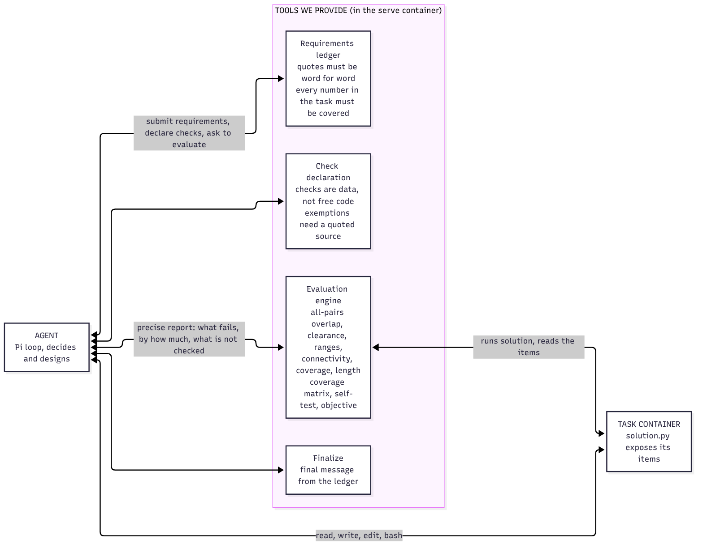

# Schematics for the write-up

Three figures, redrawn to match what is built (2026-11-27). Sources are the `.mmd` files in `docs/figures/`; the PNGs
are rendered at 2x with mermaid-cli (`mmdc -p pp.json -i X.mmd -o X.png -s 2`). Regenerate after any change to the
harness.

## Figure 1. How a run works

The evaluator starts the task container (the files, no network) and our harness, relays every read, run and write the
agent asks for, and grades the files on disk afterwards. The language model is one shared box: the agent asks it for
its next action, and the evaluator asks it for rubric scores on judged tasks. Every arrow has a reply.

## Figure 2. The ladder: one change per rung

Rung 0 is one model call. Rung 1 adds a loop and tools with the same information up front. Rung 2 moves the data out of
the first message, adds the `read` tool, and asks for a method (requirements, data check, checks, double-check).
Guards shown are the ones built into that version: the input guard and 20-call budget in rung 1, the 40-call budget in
rung 2. Versions are listed in `docs/harness-versions.md`.

## Figure 3. The agent loop (rungs 1 and 2)

Each model reply is one call. A reply with a tool call runs the tool through the evaluator and returns the result; a
reply with no tool call is the final answer. If the call budget runs out, the harness lets the last reply's tools
finish, stops the agent, and sends an honest note as the final message. Either way the evaluator then grades the files.

## Figure 4. The structured workflow (rung 3, proposed)

The agent's one free-form step is Design. Requirements, checks and the report are structured: the harness rejects a requirement it cannot find in the task word for word, an exemption without a quoted source, and offers Finish only when every requirement is checked, every check can fail and nothing is violated.

## Figure 5. The parts of the structured workflow (proposed)

Four tools we provide, in the serve container: a requirements ledger, a check declaration, an evaluation engine (all-pairs overlap, clearances, ranges, connectivity, coverage, length, a coverage matrix, a self-test, an objective tracker) and a finalizer. The engine runs outside the task container and outside the agent's code.
