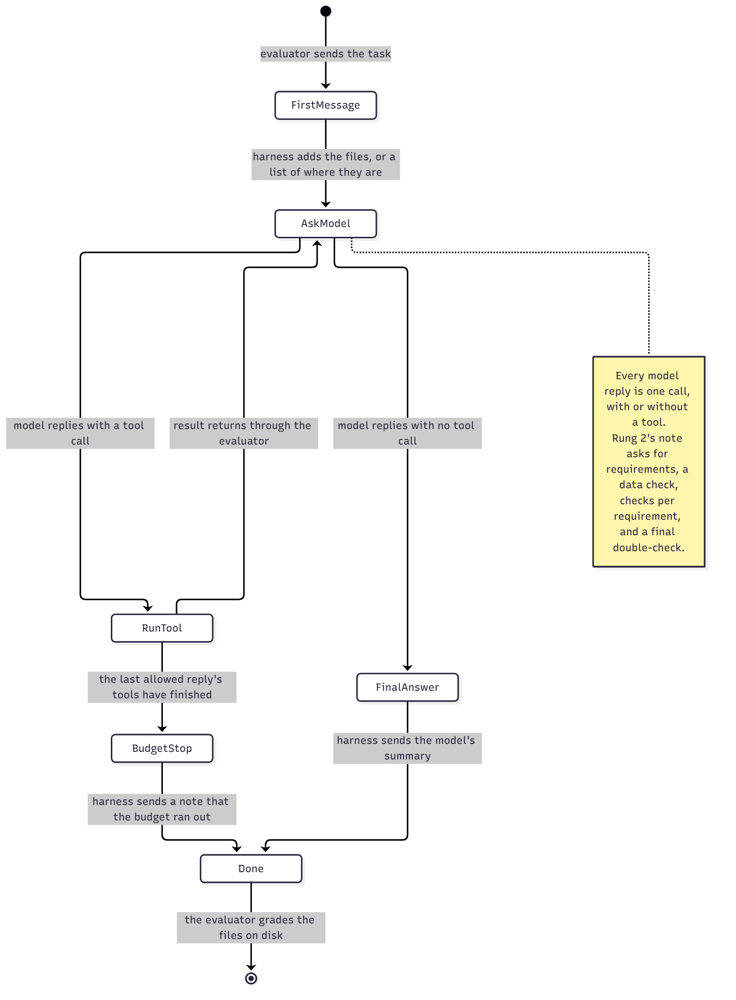

# Schematics for the write-up

Three figures, redrawn to match what is built (2026-11-27). Sources are the `.mmd` files in `docs/figures/`; the PNGs
are rendered at 2x with mermaid-cli (`mmdc -p pp.json -i X.mmd -o X.png -s 2`). Regenerate after any change to the
harness.

## Figure 1. How a run works

The evaluator starts the task container (the files, no network) and our harness, relays every read, run and write the
agent asks for, and grades the files on disk afterwards. The language model is one shared box: the agent asks it for
its next action, and the evaluator asks it for rubric scores on judged tasks. Every arrow has a reply.

## Figure 2. The ladder: one change per rung

Rung 0 is one model call. Rung 1 adds a loop and tools with the same information up front. Rung 2 moves the data out of
the first message, adds the `read` tool, and asks for a method (requirements, data check, checks, double-check).
Guards shown are the ones built into that version: the input guard and 20-call budget in rung 1, the 40-call budget in
rung 2. Versions are listed in `docs/harness-versions.md`.

## Figure 3. The agent loop (rungs 1 and 2)

Each model reply is one call. A reply with a tool call runs the tool through the evaluator and returns the result; a
reply with no tool call is the final answer. If the call budget runs out, the harness lets the last reply's tools
finish, stops the agent, and sends an honest note as the final message. Either way the evaluator then grades the files.

## Figure 4. The workflow of rung 3 (v5)

One agent. It reads the drawings, has a second reader check the facts its checks will rest on (`verify_facts`), writes its own checker (`set_checks`, probed with planted faults), builds, and evaluates (`evaluate`); when a check is wrong it rewrites it, when the design fails a check it fixes the design. Once every check passes it searches the design's parameters (`optimize`, no model calls inside the search), reads which checks the search pushed to their limits, and re-verifies the numbers behind them before accepting the design.

## Figure 5. What we provide (rung 3, v5)

The agent is the same Pi loop as in rungs 1 and 2. Four tools are ours, all in the serve container and deterministic: the check library with its probes, the evaluation (diagnosed messages, margins, scope shadows, self-test, per-kind coverage, objective), the optimizer, and the second reader. The first versions of this figure showed a separate check-builder agent; the v1 runs showed why it was dropped (`docs/design-decisions.md`, "Rung 3 v1, second Neon run").
