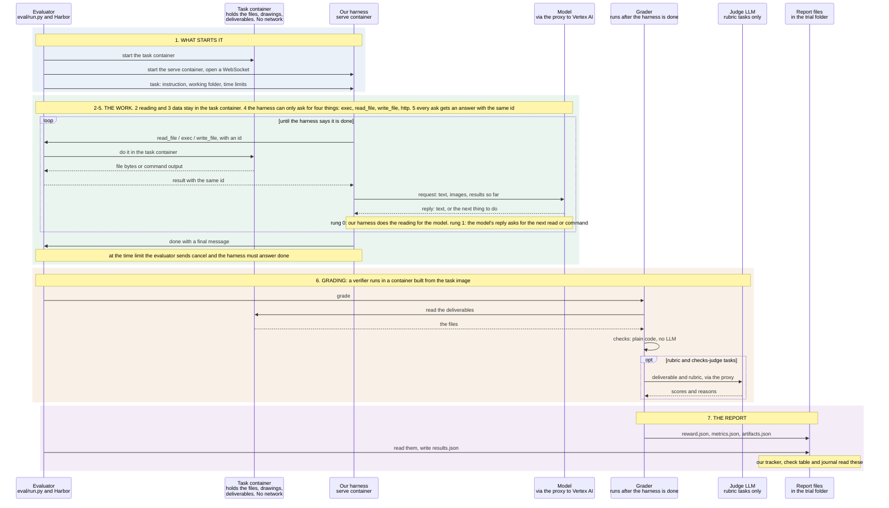

# How a run works, in one picture

Read the picture top to bottom. The numbers are your seven questions:
1 what starts it, 2 how the model reads data, 3 where data lives, 4 what it can call, 5 how it talks to the
evaluator, 6 how the evaluator works (and its LLM), 7 how the report is written.

## The same seven answers, in a line each

1. **Starts:** the evaluator starts a task container and a serve container (our harness), opens a WebSocket and sends the task.
2. **Reads:** rung 0, our harness reads the files and attaches them to one request. Rung 1, the model asks for each file with a `read` tool.
3. **Lives:** files, drawings, notes and deliverables are in the task container. The harness only ever sees what it asks for.
4. **Calls:** four actions only: `exec`, `read_file`, `write_file`, `http` (to the task's own tool servers, none here). Plus `log`, `usage`, `done`, `error` going the other way.
5. **Talks:** JSON messages over the WebSocket. Each ask has an id and gets one result back. The harness ends with `done`; at the time limit the evaluator sends `cancel`.
6. **Grades:** after the harness is done, a verifier runs in a container built from the task image. Task types: checks (plain code), rubric (an LLM judge), checks-judge (both). The judge is reached through the same model proxy.
7. **Reports:** the grader writes `reward.json`, `metrics.json`, `artifacts.json`; the evaluator collects them into `results.json`; our tracker, check table and journal are built from those.

What we do not know: the grader's internals (we do not open them) and exactly what the LLM judge is shown.
