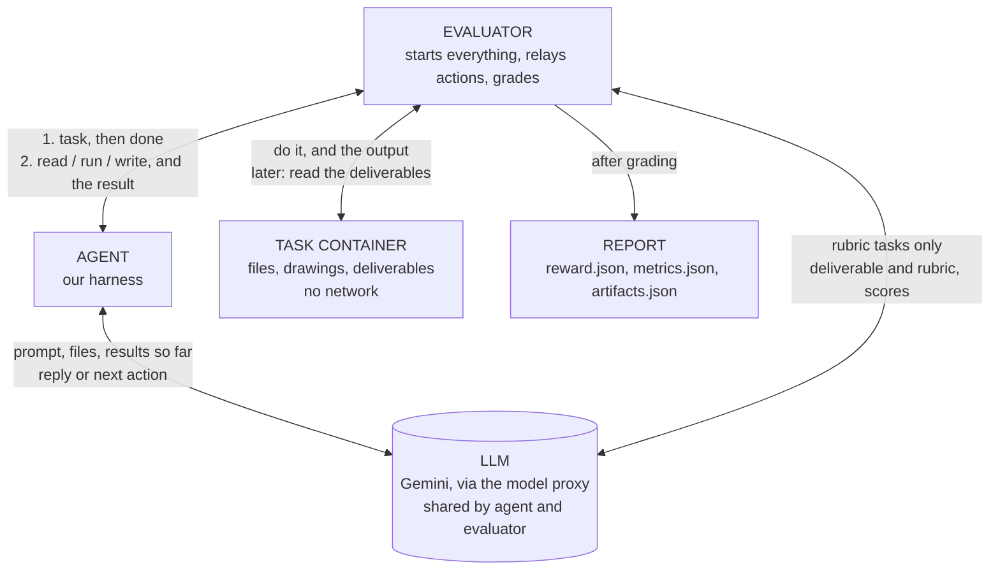

# How a run works

1. **Starts:** the evaluator starts the task container and our agent, and sends the task.
2. **Agent and data:** the agent never touches files. It asks the evaluator to read, run or write; the evaluator does it in the task container and sends the result back. Four actions exist: `exec`, `read_file`, `write_file`, `http`.
3. **Agent and LLM:** the agent sends the model the prompt, files and results so far, and gets a reply or the next action.
4. **Evaluator and LLM:** after the agent says `done`, the evaluator grades. Plain-code checks need no LLM; rubric tasks send the deliverable and rubric to the same LLM bucket and get scores back.
5. **Report:** the evaluator writes three JSON files, which our tracker and journal read.
