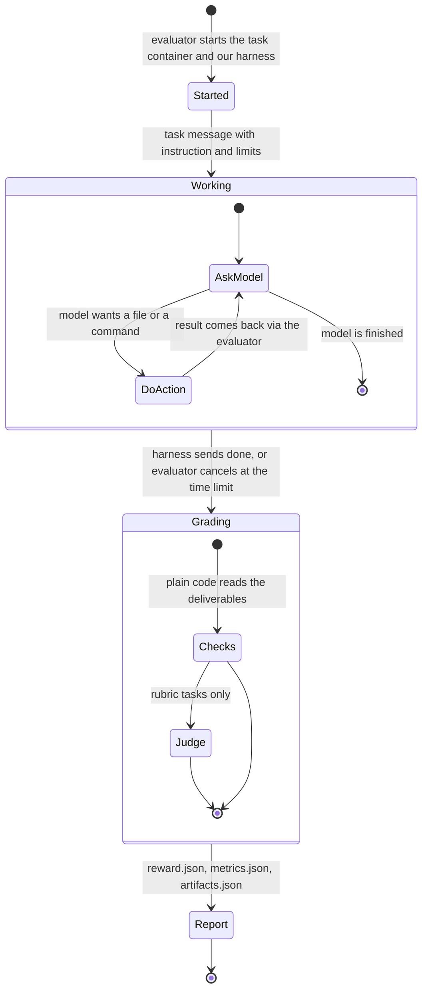

# How a run works

1. **Starts:** the evaluator starts a task container (files, drawings, deliverables, no network) and a serve container (our harness).
2. **Reads and calls:** the model never touches files itself. Each read or command goes harness, evaluator, task container, and the result returns the same way. Only four actions exist: `exec`, `read_file`, `write_file`, `http`.
3. **Ends:** the harness sends `done`; at the time limit the evaluator sends `cancel` and the harness must still send `done`.
4. **Grades:** a verifier in the task image runs plain-code checks; rubric tasks also call an LLM judge through the model proxy.
5. **Report:** the grader writes three JSON files, the evaluator collects them into `results.json`, and our tracker and journal read those.
